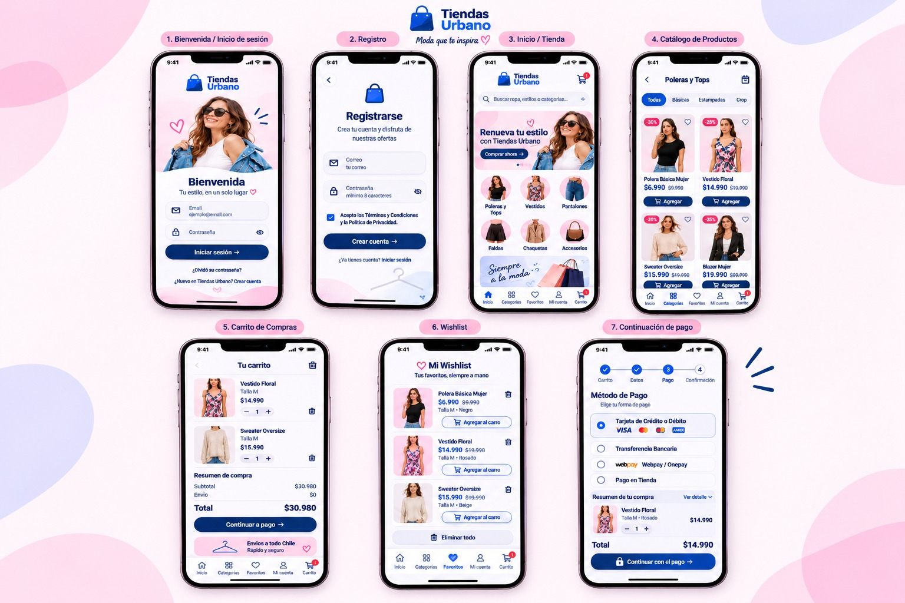
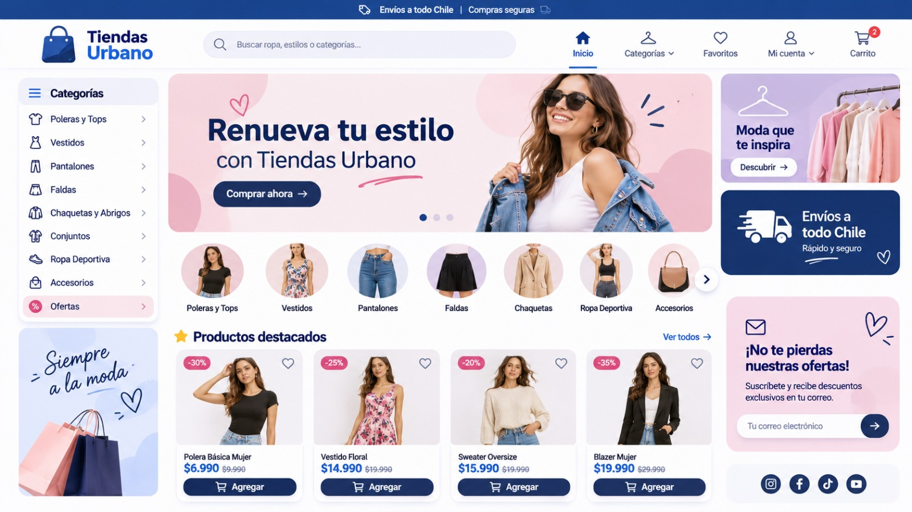

# Tiendas Urbano — Prototipo funcional

Prototipo funcional de una tienda de ropa femenina online para la empresa ficticia **Tiendas Urbano**, desarrollado para el curso de **Ingeniería de Requisitos**.

🔗 **Ver la página:** https://benjaduocuc.github.io/tiendas-urbano/

> Es un prototipo: los pagos, correos y envíos son **simulados**. Los datos (cuentas, carrito, pedidos) se guardan solo en el navegador de quien lo usa.

## Diseño de referencia

El prototipo se basa en los diseños de la carpeta [`docs/`](docs/):

| Versión móvil | Versión escritorio |
|---|---|
|  |  |

## Qué se puede hacer

**Como clienta**
- Navegar 70 productos en 7 categorías, buscar (con sugerencias y sin importar tildes), filtrar por talla, precio y color, y ordenar.
- Ver la ficha de cada producto, elegir talla y cantidad, ver la foto en grande y guardar favoritos.
- Usar el carrito con cupones de descuento y barra de envío gratis.
- Registrarse con cualquier correo de prueba (ej. `ana@prueba`, contraseña de 4 caracteres o más).
- Pagar en 4 pasos: carrito, datos (despacho o retiro en tienda), método de pago y confirmación.
- Revisar sus pedidos, escribir por el formulario de contacto y leer las páginas de ayuda.

**Cupones de prueba:** `URBANO10` (10%), `BIENVENIDA` (15% desde $20.000), `ENVIOGRATIS`.

**Como dueño de la tienda** (enlace "Panel del dueño" al pie de la página)
- Correo `dueno@urbano.cl` · contraseña `dueno123` (solo para la demostración).
- **Resumen:** al entrar ve de un vistazo pedidos por preparar, productos agotados o con poco stock, mensajes y ventas, más una guía de "¿Qué quieres hacer?".
- **Inventario:** cantidad por talla con botones **+** y **−** (o escribiendo el número); se guarda solo. Filtros "Poco stock" y "Agotados".
- La tienda respeta el stock: tallas en 0 aparecen agotadas, avisa "¡Quedan solo N!", no deja comprar más de lo que hay y cada compra descuenta unidades.
- **Pedidos:** cambiar el estado (Recibido, En preparación, Enviado / Listo para retiro, Entregado, Cancelado). La clienta lo ve en "Mis pedidos" y al cancelar las unidades vuelven al inventario.
- Subir, editar, ocultar y borrar productos; cambiar precios, ofertas y stock; subir fotos arrastrándolas desde el escritorio.
- Editar los banners de la portada y ver mensajes de clientas y suscripciones al boletín.

## Cómo abrirlo en el computador

No necesita instalar nada: descarga el proyecto y abre `index.html` con el navegador.

## Pruebas automáticas

`pruebas.js` contiene 148 pruebas (navegación, búsqueda, carrito, cupones, registro, pago, stock e inventario, estados de pedido, panel del dueño, intentos de inyectar código y una prueba con 400 acciones al azar).

1. Abre la tienda en el navegador.
2. Presiona `F12` y entra a la pestaña **Consola**.
3. Pega el contenido de `pruebas.js` y presiona Enter.

Al final muestra cuántas pruebas pasaron. Ojo: borra los datos guardados de la tienda en ese navegador.

## Estructura

```
index.html     Toda la tienda (HTML, CSS y JavaScript en un solo archivo)
pruebas.js     Pruebas automáticas
img/           Fotos de productos, banners y tarjetas
docs/          Diseños originales de referencia
```

## Créditos

- Fotos de productos y banners: [Unsplash](https://unsplash.com/license) y [Pexels](https://www.pexels.com/license/), de uso libre.
- Tipografías: Poppins y Dancing Script (Google Fonts).
- Las marcas, productos, precios y datos de contacto son ficticios.
